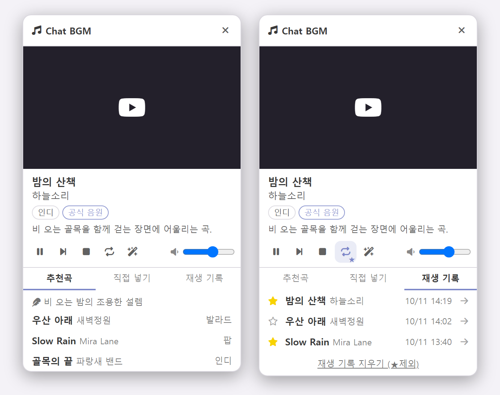
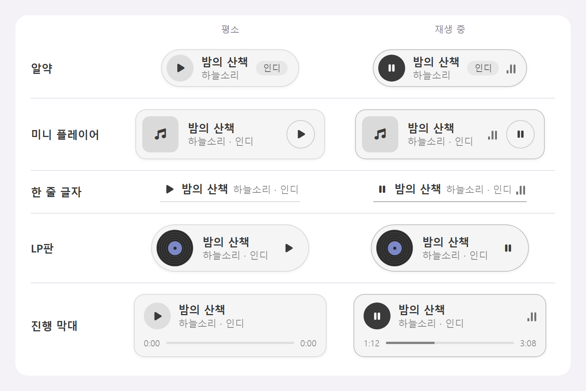

# 🎵 Chat BGM

SillyTavern 확장입니다. 최근 대화를 읽고 장면에 어울리는 곡을 골라 YouTube 공식 음원으로 틀어 줍니다.

- 곡은 설정에서 **체크한 장르 안에서만** 추천합니다.
- YouTube에서 공식 음원(아티스트의 Topic 채널, Official Audio)과 공식 채널 영상을 골라 재생하고, 커버·라이브·리믹스·1시간 반복 영상은 걸러 냅니다.
- 캐릭터 답장이 몇 개 쌓일 때마다 장면을 다시 읽어 분위기에 맞게 곡을 바꿉니다.



## 설치

SillyTavern의 **확장 → 확장 설치**에 이 저장소 주소를 넣습니다.

```
https://github.com/STLoft/Chat-BGM
```

## 준비: YouTube API 키 만들기

곡을 YouTube에서 찾으려면 YouTube Data API v3 키가 필요합니다. 무료이고 결제 정보를 등록하지 않아도 되며, 5분쯤 걸립니다.

1. [Google Cloud 콘솔](https://console.cloud.google.com/)에 Google 계정으로 로그인합니다.
2. 화면 맨 위의 프로젝트 이름을 눌러 프로젝트를 고르거나 **새 프로젝트**를 만듭니다. 이름은 아무거나 괜찮습니다.
3. 왼쪽 메뉴 **API 및 서비스 → 라이브러리**에서 `YouTube Data API v3`를 찾아 **사용**을 누릅니다.
4. **API 및 서비스 → 사용자 인증 정보**에서 **+ 사용자 인증 정보 만들기 → API 키**를 누릅니다. `AIza`로 시작하는 키가 뜨면 복사합니다.
5. 만든 키를 눌러 **API 제한사항 → 키 제한**을 고르고 `YouTube Data API v3`만 체크한 뒤 저장합니다.
6. SillyTavern의 **확장 설정 → 🎵 Chat BGM → YouTube Data API v3 키** 칸에 붙여 넣습니다.

알아 둘 점:

- **애플리케이션 제한사항은 "없음"으로 둡니다.** "웹사이트"로 제한하면 SillyTavern에 접속하는 주소를 정확히 등록해야 하고, 휴대폰처럼 다른 주소로 접속하면 막힙니다.
- **다른 용도로 쓰던 키를 그대로 넣지 마세요.** 키는 SillyTavern 설정 파일에 그대로 저장되고, 검색할 때마다 브라우저에서 주소에 붙여 보냅니다. 같은 프로젝트 안에 이 확장 전용 키를 하나 더 만들어 5번처럼 제한해 두면, 키가 새어 나가도 YouTube 검색에만 쓰입니다. 이미 쓰는 프로젝트에 만들어도 되지만 3번의 **사용**은 그 프로젝트에서 따로 눌러야 합니다.
- 키를 만든 직후 몇 분 동안은 키가 올바르지 않다는 오류가 날 수 있습니다. 잠시 뒤 다시 시도하면 됩니다.
- 콘솔의 메뉴 이름은 Google이 가끔 바꿉니다.

### API 할당량

YouTube Data API는 프로젝트마다 하루 **10,000**의 할당량을 무료로 줍니다. 이 확장은 곡 하나를 YouTube에서 찾을 때 검색을 한 번 하고, 검색 한 번이 **100**을 씁니다. 그래서 새로 찾을 수 있는 곡은 하루 약 100곡입니다.

| 할당량을 쓰는 것 | 쓰지 않는 것 |
| --- | --- |
| 처음 듣는 곡을 찾을 때 (곡마다 100) | 찾아 둔 곡을 다시 틀 때 |
| 공식 음원을 못 찾아 다음 후보를 찾을 때 (후보마다 100) | 재생 기록·★ 곡들 반복·곡 카드로 이미 들은 곡을 틀 때 |
| | 재생, 일시정지, 썸네일 표시 |
| | 모델에게 추천을 받는 것 (모델 쪽 사용량은 따로 듭니다) |

- 추천받은 후보를 한꺼번에 찾지 않고, 틀 차례가 된 곡만 찾습니다.
- 찾은 결과는 최근 300곡까지 기억합니다. 설정의 **재생 기록·검색 기억 지우기**를 누르면 이 기억도 지워져, 같은 곡을 다시 찾을 때 할당량이 듭니다.
- 한도를 다 쓰면 "오늘 쓸 수 있는 YouTube 검색 할당량을 다 썼습니다"라는 안내가 뜨고, 이미 찾아 둔 곡만 틀 수 있습니다. 한도는 태평양 시간 자정(한국 시간 오후 4~5시)에 다시 채워집니다.
- 쓴 양은 Google Cloud 콘솔의 **API 및 서비스 → 사용 설정된 API 및 서비스 → YouTube Data API v3 → 할당량**에서 볼 수 있습니다.
- 할당량은 키가 아니라 프로젝트 단위입니다. 같은 프로젝트에서 키를 여러 개 만들어도 한도는 늘지 않습니다.
- 아끼려면 **답장 N개마다 장면을 다시 읽기**의 숫자를 키우거나, 마음에 드는 곡에 별표를 달아 **★ 곡들 반복**으로 듣는 방법이 있습니다.

키가 없어도 추천 목록은 받을 수 있습니다. 이때는 곡 이름을 누르면 YouTube 검색이 새 창으로 열립니다.

## 쓰는 법

1. **확장 설정 → 🎵 Chat BGM**에서 듣고 싶은 장르를 체크합니다.
2. 빠른 답장(Quick Reply) 줄의 🎵 아이콘을 누르면 지금 장면을 읽고 곡을 틀어 줍니다.

| 동작 | 결과 |
| --- | --- |
| 🎵 아이콘 누르기 | 음악이 없으면 추천받아 재생, 있으면 재생·일시정지 |
| 🎵 아이콘 꾹 누르기 (PC는 우클릭) | 플레이어 열기·닫기 |
| 메시지의 🎵 단추 (메시지 단추 줄의 ⋯ 안) | 그 메시지까지의 대화로 추천 |
| 마법봉 메뉴의 Chat BGM | 플레이어 열기·닫기 |

빠른 답장을 쓰지 않으면 아이콘은 입력창 왼쪽 단추 줄에 붙습니다.

플레이어에는 영상과 조작 단추, **추천곡**(대기 중인 후보), **직접 넣기**, **재생 기록**(최근 100곡) 탭이 있습니다. 목록의 곡을 누르면 바로 틉니다. **직접 넣기**에 YouTube 주소를 붙여 넣으면 그 영상을 그대로 틉니다. 검색 할당량을 쓰지 않고, 튼 곡은 재생 기록에 남아 별표를 달거나 메시지에 카드로 붙일 수 있습니다. 재생 기록의 ☆를 눌러 별표를 달아 두면 기록을 지워도 그 곡은 남습니다. 🔁 단추는 누를 때마다 반복 끔 → 한 곡 반복 → ★ 곡들 반복으로 바뀝니다. 플레이어를 닫아도 음악은 계속 나오며, 끄려면 ■ 단추를 누릅니다. 머리 부분을 끌어서 옮길 수 있습니다.

## 곡 카드

설정에서 **캐릭터 답장 N개마다 곡 카드 넣기**를 켜면, 답장을 쓰는 모델이 N번째 답장마다(기본 6) 장면에 맞는 곡을 하나 골라 답장 끝에 적고 그 메시지 본문 맨 위 가운데에 곡 카드가 붙습니다. 카드를 누르면 그 곡을 틀고, 다시 누르면 일시정지합니다.

메시지의 🎵 단추로 추천받은 곡도 그 메시지에 카드로 남습니다(설정에서 끌 수 있습니다). 숨긴 메시지나 지나간 메시지에서도 됩니다. 이 카드는 본문을 고치지 않고 채팅 파일에 따로 저장됩니다.

이미 붙은 카드를 다른 곡으로 바꾸거나 카드가 없는 메시지에 붙이려면, 플레이어의 **재생 기록**에서 곡 오른쪽의 → 를 누르고 메시지 번호를 적습니다. 그 메시지에 카드가 있으면 그 곡으로 바뀌고, 없으면 새로 붙습니다.

카드를 떼려면 메시지를 편집해 맨 끝의 `<bgm …>` 줄을 지웁니다. 설정에서 **카드에 삭제(✕) 버튼 보기**를 켜면 카드 오른쪽 바깥에 ✕가 생겨 화면에서 바로 뗄 수 있습니다. ✕로 모델이 적은 카드를 떼면 본문의 `<bgm …>` 줄이 지워져 되돌릴 수 없습니다. 🎵 단추로 붙인 카드는 본문에 적히지 않으므로 ✕로만 뗄 수 있습니다.

카드 모양은 설정의 **카드 모양**에서 고릅니다: 알약, 미니 플레이어, 한 줄 글자, LP판, 진행 막대. 미니 플레이어와 LP판은 한 번이라도 재생한 곡이면 YouTube 썸네일을 함께 보여 줍니다.



- 추천용 호출이 따로 들지 않는 대신, 카드를 넣을 차례의 답장 프롬프트에 지시문과 장르 목록이 추가됩니다. 숫자를 1로 두면 답장마다 카드가 붙습니다.
- 이 숫자는 **답장 N개마다 장면을 다시 읽기**와는 별개입니다. 그쪽은 음악이 나오는 동안 모델을 따로 불러 추천곡을 새로 받는 간격입니다.
- 모델이 적은 `<bgm …>` 한 줄은 화면에는 보이지 않지만 메시지에 남아 다음 프롬프트에도 들어갑니다.
- 체크한 장르에서 벗어난 곡은 카드로 그리지 않습니다.

## 설정

| 항목 | 설명 |
| --- | --- |
| 장르 | 체크한 장르 안에서만 추천합니다. 목록에 없는 장르는 **직접 적는 장르**에 쉼표로 구분해 적습니다. |
| 가사 없는 연주곡만 | 보컬이 없는 곡만 추천받습니다. |
| 공식 음원·공식 채널 영상만 재생 | 공식으로 확인되지 않는 영상은 건너뛰고 다음 후보를 찾습니다. |
| 분석에 쓸 연결 | 추천받을 때마다 모델을 한 번 부릅니다. 연결 프로필을 고르면 그 모델로, 비워 두면 지금 쓰는 모델로 부릅니다. |
| 캐릭터 답장 N개마다 장면을 다시 읽기 | 음악이 나오는 동안, 대화가 진행되면 새 장면에 맞는 곡을 다시 고릅니다. |
| 새 곡이 정해지면 바로 바꾸기 | 끄면 듣던 곡이 끝난 뒤에 새 곡으로 넘어갑니다. |
| 카드가 붙은 답장이 오면 자동으로 틀기 | 곡 카드를 켰을 때, 새 답장의 곡을 누르지 않아도 틉니다. |
| 곡이 끝나면 | **다음 추천곡으로**: 후보가 떨어지면 장면을 다시 읽어 새로 추천받습니다. **한 곡 반복**: 지금 곡을 되풀이합니다. **★ 곡들 반복**: 재생 기록에서 별표 단 곡들을 차례로 돕니다. 반복 중에는 "답장 N개마다 다시 읽기"를 쉽니다. |

## 알아 둘 점

- 브라우저는 사용자가 누르지 않은 소리 재생을 막기도 합니다. 그때는 안내가 뜨니 🎵 아이콘을 한 번 눌러 주세요.
- YouTube가 곡 앞에 광고를 붙일 수 있습니다. 건너뛰려면 플레이어를 열어 영상에서 직접 눌러야 합니다.
- 휴대폰에서는 화면이 꺼지거나 브라우저가 뒤로 가면 YouTube 재생이 멈춥니다.
- 일부 음원은 권리자가 다른 사이트에서의 재생을 막아 두었습니다. 그런 곡은 자동으로 건너뜁니다.
- 모델이 실제로 없는 곡을 지어내면 YouTube에서 찾지 못해 건너뜁니다.
